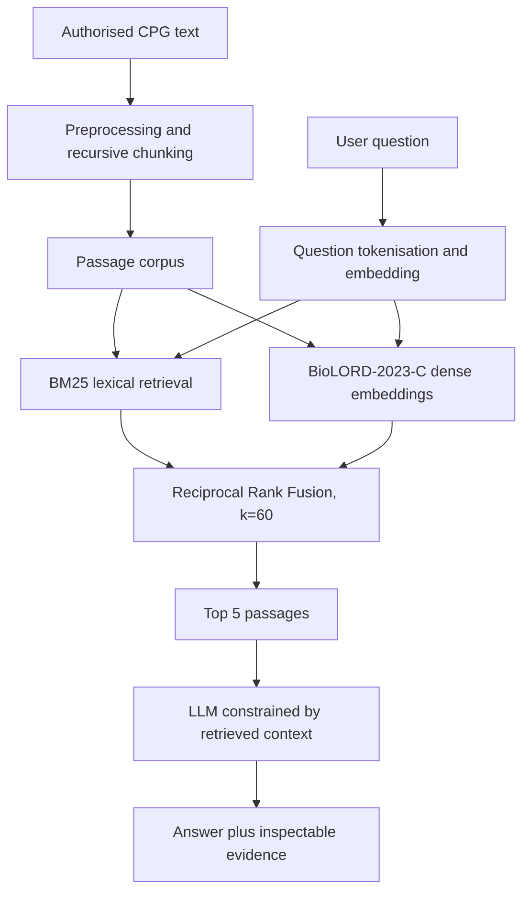

# Architecture

The Streamlit implementation included in this repository builds a local lexical index and dense embeddings from `data/local/recursive_chunks.csv` at runtime. It uses RRF to combine the BM25 and dense rankings. This implementation is intended to make the core design inspectable; re-run the original notebooks and compare outputs before claiming exact equivalence to every experimental run.
